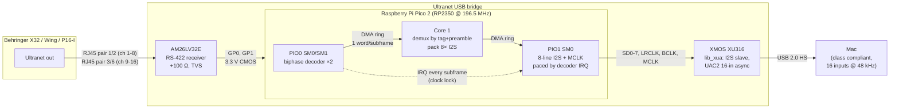

# Ultranet → 16-channel USB audio interface for macOS

Goal: a small box. An Ultranet cable from an X32, Wing, P16-I or similar goes
in, and a USB-C cable goes to a Mac. The Mac sees a **class-compliant
16-input audio device** with no driver, and records bit-exact audio at the
console's own 48 kHz clock.

## 1. Why two chips

| Requirement | Consequence |
|---|---|
| 16 ch × 24-bit container × 48 kHz = 18.4 Mbit/s of audio | **USB Full-Speed (12 Mbit/s) is too slow.** You need USB 2.0 High-Speed (480 Mbit/s). That rules out the RP2040/RP2350 doing USB by themselves. |
| Two 24.576 MBd biphase streams | You need cycle-accurate input sampling: PIO, an FPGA, or xcore. A Linux SBC can't do it in software. |
| Mac must not need drivers | USB Audio Class 2.0, async mode. |
| Bit-exact, no clicks | The whole chain has to follow the **console's** clock, without resampling and without dropped or repeated samples. |

Single-board options considered:

| Platform | Ultranet decode | 16-ch USB to Mac | Verdict |
|---|---|---|---|
| **Pico 2 (RP2350)** | Excellent (PIO; proven by doughadfield) | No: Full-Speed USB only | Use as the **decoder** |
| Teensy 4.1 | No PIO. Would need FlexIO/SPDIF-RX trickery | HS USB, but the core only ships stereo USB audio. 16-ch UAC2 means rewriting descriptors and buffers; nobody has published it working | Possible, high risk |
| Raspberry Pi Zero 2 / 4 / CM4 | No: no deterministic input sampling (Pi 5's RP1 has PIO but its USB-C port has no gadget mode) | Linux `f_uac2` gadget with `p_chmask=0xFFFF`. 16-ch on the dwc2 controller isn't verified, and clock control is awkward | Plan C |
| **XMOS xcore.ai (XU316)** | Possible in software (lib_spdif 192 kHz RX ×2 plus a custom deinterleave) | **Yes**: `sw_usb_audio`/`lib_xua` is the reference UAC2 stack used in commercial interfaces. 16-in I2S-slave is a config option | Use as the **USB bridge** (and maybe later the only chip, see §8) |
| FPGA (Nöding, HyperNet) | Excellent | No USB audio IP | Overkill for this job |

**Chosen architecture: Pico 2 (Ultranet → 8× I2S) + XMOS XU316 (I2S slave → USB Audio Class 2).**
Both halves use well-trodden open-source code. The only new parts are the
small PIO programs and data path in this repo, which are verified in a
cycle-level simulation.

## 2. Block diagram



## 3. Clocking: one clock from console to Mac

1. The console's word clock drives the Ultranet bit stream.
2. Each Ultranet preamble makes decoder SM0 set PIO IRQ flag 0 (384 kHz).
3. The I2S SM in PIO1 waits on that flag (`wait 1 irq prev, 0`). It clocks out
   exactly 8 BCLKs (with 32 MCLKs) per Ultranet subframe and then waits
   again. **BCLK, LRCLK and MCLK are therefore locked to the console.** Each
   8-bit chunk takes about 505 of the 511.7 system cycles, so one BCLK low
   phase in eight is about 7 cycles (≈35 ns) longer. A clock-slave input
   doesn't care.
4. The XMOS runs as I2S slave (`CODEC_MASTER=1`) and counts MCLK on its USB
   tile. In async UAC2 the Mac follows the device's rate.

Nothing in the chain resamples, and no buffer can drift. The simulation shows
the output buffer level staying flat over 240 frames with the source ±300 ppm
off nominal (`tools/test_ultranet.py`).

If there's no Ultranet signal, a 3-instruction **pacer** SM supplies the IRQ
instead (free-run mode, about 48 kHz, silence). The XMOS always has a clock,
and the Mac sees a stable device whether the cable is plugged in or not.

## 4. Hardware

### 4.1 Input stage (per pair, ×2)

```
RJ45 pin 1 ──┬──────────────┐                    ┌─────────────┐
             │ TVS (opt.)   ├── 100 Ω ──┐        │ AM26LV32E   │
RJ45 pin 2 ──┴──────────────┘           └── A+/A-│ (3.3 V)     │── 1Y ──► GP0
RJ45 pin 3 ── ... same ... pin 6 ────────── B+/B-│             │── 2Y ──► GP1
RJ45 4,5,7,8: NOT CONNECTED (may carry DC)        └─────────────┘
```

* **AM26LV32E**: quad RS-422 receiver, 3.3 V supply, 32 Mbit/s, inputs
  tolerate ±14 V common mode. Alternatives: MC3486 (5 V, outputs then need a
  divider to 3.3 V), SN65HVD3082E class, or DS90LV032 if the levels turn out
  LVDS-like.
* 100 Ω across each pair at the receiver (Cat5 impedance).
* ESD: a 4-line TVS array (e.g. TPD4E05U06) on the RJ45 lines.
* Optional galvanic isolation against hum loops: put a 10/100 Ethernet pulse
  transformer (1:1) between the jack and the receiver. The 24.576 MBd signal
  passes easily.
* **Don't Y-split a link that's already working.** It double-terminates the
  line. Connect to a free Ultranet output: X32 "P16" port, a P16-D output, or
  a P16-M "Thru".

### 4.2 Pico 2 pin map

| GPIO | Function | To |
|---|---|---|
| GP0 | Ultranet stream A in (ch 1–8) | AM26LV32E 1Y |
| GP1 | Ultranet stream B in (ch 9–16) | AM26LV32E 2Y |
| GP2–GP9 | I2S SD0–SD7 (SD*k* = ch 2k+1 / 2k+2) | XMOS PORT_I2S_ADC0–7 |
| GP10 | I2S LRCLK, 48 kHz | XMOS PORT_I2S_LRCLK |
| GP11 | I2S BCLK, 3.072 MHz (64 fs) | XMOS PORT_I2S_BCLK |
| GP12 | MCLK, 12.288 MHz (256 fs), locked | XMOS PORT_MCLK_IN (tile 1) **and** PORT_MCLK_IN_USB (tile 0) |
| GP25 | LED, on while locked to stream A | |
| USB | CDC serial console: lock status, error counters, level meters | your computer (debug only) |

I2S format: Philips, 32-bit slots, MSB first, 22-bit audio left-justified,
bottom 10 bits zero.

### 4.3 XMOS side

`firmware/xmos/app_ultranet_usb` is an overlay for `xmos/sw_usb_audio`.
Settings: 16 in / 0 out, 48 kHz only, I2S slave, no mixer. Port map:
`ultranet_bridge.xn`. Which board to use:

* **Prototype:** an xcore.ai development board that brings out tile-1 1-bit
  ports 1B, 1C, 1D and 1I–1P on headers. On the XK-AUDIO-316-MC some of those
  lines are wired to the on-board ADC/DAC, which then have to be held in reset
  or have resistors removed. Check the board's schematic against the `.xn`
  and change the port locations to match.
* **Final product:** a custom 2-layer board with an XU316-1024-QF60B, a 24 MHz
  crystal, QSPI flash, USB-C and a 3.3 V/0.9 V supply. Copy it from the XMOS
  reference designs. The Pico-equivalent RP2350A can go on the same PCB.

### 4.4 Bill of materials (prototype)

| Part | Qty | ≈ Cost |
|---|---|---|
| Raspberry Pi Pico 2 | 1 | $5 |
| AM26LV32E (SOIC-16) | 1 | $2 |
| RJ45 jack (shielded), 100 Ω resistors, TVS array, decoupling caps | 1 set | $4 |
| xcore.ai dev board with free tile-1 ports (or custom XU316 board) | 1 | $100–200 dev / ~$25 custom |
| Perfboard or small PCB, wires (keep I2S wires < 10 cm) | | $5 |

The finished custom board (RP2350 + XU316 + receiver on one PCB) should come
in around **$35–45 BOM**.

## 5. Firmware

| Part | Where | Status |
|---|---|---|
| PIO biphase decoder (27 instr.), pacer (3), 8-line I2S + MCLK (10) | `firmware/rp2350/src/ultranet.pio` | Assembled with pioasm; cycle-simulated |
| Demux / validation / I2S packing (portable C) | `firmware/rp2350/src/ultranet_core.c` | Unit-tested on the host |
| RP2350 main: clocks, DMA rings, core-1 data path, polarity auto-detect, USB console | `firmware/rp2350/src/main.c` | Compiles for `pico2` with pico-sdk 2.1.1, zero warnings; **not yet run on hardware** |
| XMOS UAC2 bridge config | `firmware/xmos/app_ultranet_usb` | Config only; **not built** (needs XMOS XTC tools) |

Data path per stream: PIO RX FIFO → endless DMA into a 16 KiB ring (≈10 ms).
Core 1 checks the preamble code and parity, takes the channel from tag +
preamble, and keeps per-channel peaks. When channel 8 of stream A arrives, it
packs the 16 channels into 32 words and writes them to the 8 KiB output ring.
Endless DMA feeds those into PIO1. The output ring sits about 8 frames ahead
(≈167 µs), and whole frames are dropped or repeated only if something stalls.

Polarity: if a pair is wired backwards, the decoder sees no valid preambles.
Core 0 then flips the GPIO input inversion every 250 ms until frames appear.

### Measured in simulation (`tools/test_ultranet.py`)

* Bit-exact end to end on all 16 channels (pins in → I2S pins out).
* Source clock offset ±2000 ppm: no errors (the RP2350 crystal is ±30 ppm).
* Random edge jitter: clean at 3 ns RMS (0.07 UI). It breaks down around
  5 ns RMS. A healthy RS-422 link over tens of metres of Cat5 should be well
  under 1 ns of random jitter, but check the eye on a scope if you see
  `par`/`code` errors on the console.
* MCLK/BCLK = 4.000; output buffer level constant (clock lock works).

## 6. Bring-up plan

1. **Look at the signal.** Scope across the 100 Ω termination: amplitude,
   rise times, DC on pins 4/5/7/8.
2. **Capture it (optional, best for the open questions).** Logic analyzer at
   ≥ 100 MS/s on the receiver output, then
   `python3 tools/ultranet_ref.py analyze cap.csv --cs --wav a.wav`.
   Listen to the WAV.
3. **Pico only.** Flash `ultranet_bridge.uf2` (hold BOOTSEL, drag and drop).
   Open the USB serial port (`screen /dev/tty.usbmodem* 115200`). You should
   see `LOCKED`, about 48000 frames/s per stream, zero errors, and meters
   that move with the console faders.
4. **I2S check.** Scope or logic analyzer: LRCLK 48 kHz, BCLK 3.072 MHz, MCLK
   12.288 MHz, data on SD0–SD7.
5. **XMOS.** Build and flash the overlay, wire 11 signals + GND.
6. **Mac.** Audio MIDI Setup should show "Ultranet 16", 16 inputs, 48 kHz.
   Record in Logic, Reaper or Audacity.

Building the Pico firmware:

```sh
git clone -b 2.1.1 https://github.com/raspberrypi/pico-sdk.git
(cd pico-sdk && git submodule update --init lib/tinyusb)
export PICO_SDK_PATH=$PWD/pico-sdk
cmake -S ultranet/firmware/rp2350 -B build && make -C build -j
# -> build/ultranet_bridge.uf2
```

## 7. Limitations and risks

* **Resolution is 22 bits**, a limit of Ultranet itself. The Mac sees 24-bit
  samples with zero LSBs.
* 48 kHz only. Fine for X32/Wing/P16; a 96 kHz Wing setting has not been
  studied.
* The RP2350 runs at 196.5 MHz, about 30 % over its rating. Pico 2 boards are
  routinely run far higher. To stay in spec, use `T 6` in the PIO and a
  147 MHz clock instead, with less timing margin (not simulated).
* The XMOS port map depends on the board you pick (§4.3).
* Nothing here has touched a real Ultranet signal yet. The protocol facts
  come from three working projects, and the implementation is verified
  against a model of those facts.

## 8. Roadmap

1. Hardware bring-up as above. Feed real captures back into
   `PROTOCOL.md` §5.
2. Single PCB (RP2350 + XU316 + receiver + RJ45 + USB-C), bus-powered.
3. **Single-chip option:** drop the RP2350 and decode both pairs on the
   xcore.ai with two lib_spdif receivers at 192 kHz plus the same tag-based
   deinterleave, with xcore.ai's application PLL locked to the stream. That
   is cheaper and smaller, but needs custom xcore work.
4. Optional extras: Ultranet "thru" output (re-drive the received signal),
   ADAT out (2 × 8 ch on TOSLINK) for interfaces that already have ADAT
   inputs, headphone monitor of a chosen pair.
